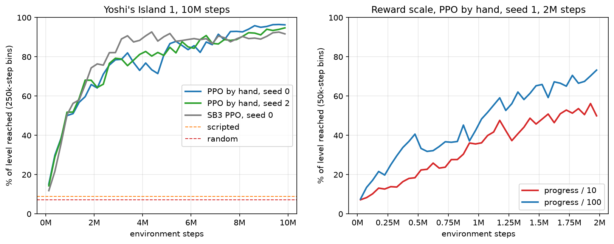
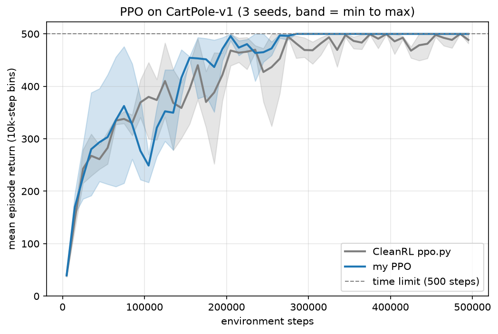

# super-mario-world-ppo

PPO written from scratch in PyTorch and trained from raw pixels to clear Yoshi's Island 1, the first level of Super Mario World. Checked against random and scripted baselines, Stable-Baselines3's PPO on the same environment, and CleanRL's reference PPO on CartPole.



Left: how far Mario got in training episodes, averaged over 250k-step bins, with the baselines' evaluation averages as dashed lines. Right: the reward scale test described below.

Video: [PPO by hand clearing the level](results/ppo_yi1_clear.mp4) (evaluation episode 0, with sound)

## Results

"PPO by hand" is the implementation in this repo. Every agent gets 20 evaluation episodes with the same fixed endings (goal, death or 4,000 steps), and sticky actions make each episode different. Progress is the furthest x Mario reached, as a % of the goal's x (4,822).

| agent | training steps | cleared | progress (% of level) |
|---|---|---|---|
| random | - | 0/20 | 7.2 ± 3.5 |
| scripted: run and jump | - | 0/20 | 8.8 ± 0.1 |
| PPO by hand, seed 0 | 10M | 17/20 | 87.9 ± 28.8 |
| PPO by hand, seed 2 | 10M | 17/20 | 91.2 ± 22.5 |
| SB3 PPO, seed 0 | 10M | 18/20 | 99.1 ± 3.0 |
| PPO by hand, reward / 10, seed 1 | 2M | 2/20 | 66.0 ± 35.0 |
| PPO by hand, reward / 100, seed 1 | 2M | 5/20 | 73.6 ± 25.6 |

- **PPO by hand clears the level in 34 of 40 episodes (85%)** over two training seeds, in 500–558 steps (33–37 s of game time). The random and scripted agents never reach 15% of the level.
- **Stable-Baselines3 clears 18/20 (90%)** with the same wrappers and settings. At 20 episodes per run the clear rates are within noise, but SB3 is more consistent: four of my agent's six failures are early deaths (x 843–1,109), while both of SB3's are near the goal (x 4,177 and 4,608).
- **Training is reproducible bit for bit.** Rerunning seed 0 for 10M steps gave identical final weights and an identical log of every training episode (on the same machine; GPU results can differ across hardware).

### Reward scale

The first version of the reward was 10× larger (progress / 10, −5 for dying, +50 at the goal), so a clear was worth about 530 instead of 53. The PPO settings come from CleanRL's Atari setup, where rewards are clipped to ±1 per step, and include value clipping at 0.1 and gradient-norm clipping at 0.5. At 2M steps (seed 1), the / 100 reward cleared 5/20 against 2/20, and its value loss over the second half of training was about 180× smaller (0.4 vs 72). The actor and critic share one CNN and the gradient is clipped as a whole, so a large value loss likely crowds out the policy's gradient. This is one seed, so it's a hint rather than a result. The 10M runs use progress / 100.

### Watching it learn

`ppo/ppo_mario.py --snapshot-every 250000` keeps a checkpoint every 250k steps, and `scripts/training_progress_video.py` joins one evaluation episode from each chosen snapshot into a single labelled video. Evaluation episode 0 for snapshots of seed 0:

| training steps | outcome |
|---|---|
| 1,024 | dies at x 411 |
| 1.0M | dies at x 2,866 |
| 2.0M | dies at x 3,835 |
| 3.0M | dies at x 3,431 |
| 4.0M | dies at x 4,550 |
| 5.0M | clears in 572 steps |
| 10M | clears in 543 steps |

## How it works

- **Environment** (`smw/env.py`): stable-retro's SNES emulator, with `smw/mario_data.json` mapping RAM addresses to Mario's x, animation state, game mode, goal flag and lives. Seven moves: right, right + run, right + jump, right + run + jump, right + spin jump, left, and jump. Each move is held for 4 frames, and on each frame there's a 0.25 chance the previous move carries on instead (sticky actions), so moves start after a random delay. Observations are grayscale, 84×84, with the last 4 frames stacked.
- **Reward** (`smw/reward.py`): +1 per 100 px of new rightmost progress, −0.5 for dying and +5 at the goal. An episode ends on death, the goal or game over, and is cut off after 250 steps without new progress or 4,000 steps in total.
- **PPO** (`ppo/ppo_mario.py`):
  - Nature-DQN CNN shared by the actor and critic.
  - GAE (γ 0.99, λ 0.95), and clipped policy and value losses (ε 0.1).
  - Value coefficient 0.5, entropy coefficient 0.01, gradient norm clipped to 0.5.
  - Adam with learning rate 2.5e-4 annealed to 0.
  - 8 environments × 128 steps per update, 4 epochs of 4 minibatches.
  - Episodes cut off by a time limit bootstrap from the value of their final observation.
  - Each emulator runs in its own process, since stable-retro allows one per process.
  - About 1,100 steps/s on an Apple Silicon laptop, so 10M steps take about 2.5 h.
- **Stable-Baselines3 cross-check** (`scripts/train_sb3.py`): SB3's `PPO("CnnPolicy")` on the same wrappers with the same settings, except that SB3 doesn't clip the value loss.
- **Evaluation** (`scripts/evaluate.py`):
  - Fixed endings that don't depend on the training reward.
  - Actions sampled from the policy.
  - Episode k uses seed k, so any episode can be replayed exactly.
  - Writes one CSV row per episode, and optionally a video with sound.

## Validation on CartPole

Before moving to pixels, I matched `ppo/ppo.py` against CleanRL's `ppo.py` on CartPole-v1 with identical settings (3 seeds, 500k steps each):

| seed | first return of 500 (steps): PPO by hand / CleanRL | mean return over the last 50k steps: PPO by hand / CleanRL |
|---|---|---|
| 0 | 30,348 / 23,640 | 500.0 / 498.5 |
| 1 | 18,016 / 14,572 | 500.0 / 489.7 |
| 2 | 22,328 / 31,164 | 500.0 / 491.9 |



The build-up to PPO:
- REINFORCE with whole-episode returns vs reward-to-go, then with a learned value baseline (`scripts/reinforce_cartpole.py`, `results/reinforce_cartpole.png`).
- GAE with unit tests (`ppo/advantages.py`, `tests/`).

## Roadmap

- [x] REINFORCE on CartPole (whole-episode return vs reward-to-go)
- [x] REINFORCE with a learned baseline
- [x] Generalized Advantage Estimation (GAE), with unit tests
- [x] PPO on CartPole, matched against CleanRL's reference implementation
- [x] PPO on Super Mario World pixels (Yoshi's Island 1)
- [ ] Next: generalization study, training on 18 levels and testing on 6 held-out levels

## Setup

Requires [uv](https://docs.astral.sh/uv/) and Python 3.12.

```
git clone https://github.com/TylerWortley/super-mario-world-ppo.git
cd super-mario-world-ppo
uv sync
```

The Super Mario World ROM is not included, so you need your own legally obtained copy. Import it into stable-retro, then check that it runs:

```
uv run python -m stable_retro.import /path/to/folder/with/rom
uv run python scripts/rom_smoke_test.py
```

Run the tests:

```
uv run pytest
```

## Reproducing the results

```
# baselines
uv run python scripts/evaluate.py --agent random
uv run python scripts/evaluate.py --agent scripted

# PPO by hand, 10M steps (seeds 0 and 2)
uv run python -m ppo.ppo_mario --seed 0
uv run python scripts/evaluate.py --agent ppo --checkpoint runs/ppo_mario/YoshiIsland1_seed0.pt

# Stable-Baselines3 cross-check
uv run python scripts/train_sb3.py --seed 0
uv run python scripts/evaluate.py --agent sb3 --checkpoint runs/sb3_mario/YoshiIsland1_seed0.zip

# reward scale test, 2M steps (seed 1); the current code uses progress / 100
uv run python -m ppo.ppo_mario --seed 1 --total-timesteps 2000000

# plot and results table
uv run python scripts/plot_mario.py

# snapshots and the progress video
uv run python -m ppo.ppo_mario --seed 0 --snapshot-every 250000
uv run python scripts/training_progress_video.py
```

- `scripts/evaluate.py` writes `results/eval/{state}_{agent}.csv`. The committed files were renamed per run, e.g. `YoshiIsland1_ppo_seed0.csv`.
- To replay a single episode k with video, add `--seed k --episodes 1 --video videos/episode.mp4`.
- For the progress / 10 run, first restore the earlier reward with `git checkout 5e8b368~1 -- smw/reward.py`, and put the current one back afterwards with `git checkout HEAD -- smw/reward.py`.

## Layout

```
ppo/       advantages.py (reward-to-go, GAE), ppo.py (CartPole), ppo_mario.py (pixels)
smw/       env.py (wrappers), reward.py, mario_data.json (RAM addresses)
scripts/   training, evaluation, plots and videos
tests/     unit tests for the advantage estimators
results/   evaluation CSVs, plots and the demo video
```
